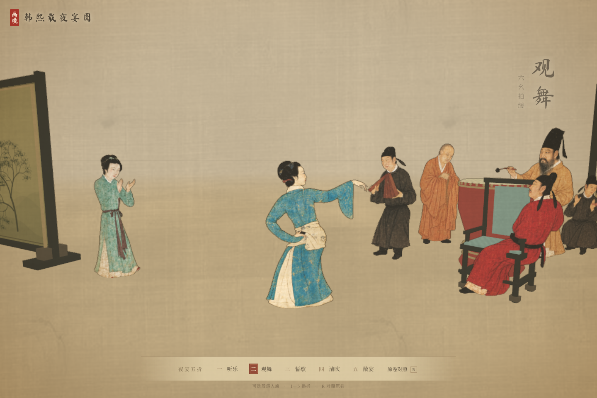

# 卷二：绢本空间与完整纸偶

2026-10-12 · `feat/hanxizai-ye-yan`

本次重做屏榻空间、45 个人物出场形象及动作。取消粗糙的封闭厅堂、通用几何人和朝向镜头的人物广告牌；保留原项目的入画、漫游与归卷。没有加入线索、对话、任务或故事推进。

## 画作依据与空间边界

- [故宫博物院藏品介绍](https://www.dpm.org.cn/collection/paint/228200.html)：原卷依次为听乐、观舞、暂歇、清吹、散宴，借屏风和家具衔接段落。
- [故宫相关介绍](https://www.dpm.org.cn/classify_detail/180639.html)：用于核对人物活动与场面。
- [Wikimedia Commons 全卷](https://commons.wikimedia.org/wiki/File:Gu_Hongzhong%27s_Night_Revels_1_complete_scene.jpg)：公有领域的宋摹本复制图。`panorama-detail.jpg` 为 13,898 × 1,200 的原文件，原有 5,200 × 449 的 `panorama.jpg` 仍保留。
- [UNESCO 中国皮影戏介绍](https://ich.unesco.org/en/RL/chinese-shadow-puppetry-00421)：参考平面偶人和活动关节的表现形式。项目为屏幕动画，并非传统皮影制作或具体舞谱的复原。

| 段落 | 核对后保留的关系 | 游览适配 |
| --- | --- | --- |
| 听乐 | 琵琶在左，宾客环坐；韩熙载与红衣郎粲共榻 | 漆案错位，留出前方走道 |
| 观舞 | 王屋山背身舞蹈，韩熙载击鼓，德明和尚站立合掌 | 独立鼓、斜置座椅，舞者前方留白 |
| 暂歇 | 围榻与帐床、净手、持琵琶和托盘侍女 | 细足榻架、帐幔、盆与搭巾 |
| 清吹 | 五位女乐合奏，韩熙载敞衣盘坐执扇 | 完整裙摆略相叠，统一坐席基线 |
| 散宴 | 黄袍高帽的韩熙载持槌，宾客与女伎相语 | 保留人物群组，屏风界定段落 |

原画没有提供可验证的完整墙顶或建筑平面。这里的连续 60 米游览空间、段间距离、屏心山水、衣物遮挡补全以及动作均属艺术转译。没有将五个时间段宣称为五间实际房间。`R` 可随时打开当前段的原卷对照。

## 人物完整性处理

此前手描轮廓会切进发髻、脸和衣袖；把相交多边形直接按奇偶规则裁剪还会在轮廓外留下多余碎片。独立关节三角片在旋转时也可能分离。这套运行时裁剪与分片方法已移除。

现在使用内置 **imagegen** 工具，以原卷分段图为参照生成透明抠图与遮挡补全素材，再逐人检查脸部、帽顶、手袖和衣摆。**这些是基于原作的生成式转译，并非原画像素的无损抠取**；不可见部位、补全衣纹及新动作会有解释性变化。未将生成图冒充原始文物图像。

选用文件保存在 [`public/paintings/hanxizai-yeyan/puppets/`](../public/paintings/hanxizai-yeyan/puppets/)，均为带真实透明通道的版本化 PNG：

| 文件 | 用途 |
| --- | --- |
| `listen-v1.png` | 听乐人物；帘后侍女与饮酒宾客另用下述专用素材 |
| `dance-v1.png` | 观舞宾客、拊掌女伎、和尚、击鼓韩熙载 |
| `rest-v1.png` | 暂歇七个人物，补全榻前遮挡 |
| `winds-v1.png` | 五位女乐、执板者、执扇韩熙载和侍女 |
| `farewell-v1.png` | 散宴六个人物 |
| `curtain-maid-v1.png` | 单独补全帘后侍女，替换首版仍带直线断面的候选 |
| `dancer-v1.png` | 舞者完整基础稿，作为动作条的参考源保留 |
| `drink-cycle-v1.png` | 持杯、举杯、饮酒、放杯四个完整姿态 |
| `dance-cycle-v1.png` | 起势、展袖、回身、收势四个完整姿态 |

所有最终提示词、参照图范围和工具记录见 [`hanxizai-image-prompts.json`](hanxizai-image-prompts.json)。使用内置工具，未使用 CLI。原卷参照范围以 5,200 × 449 坐标记载；制作时取对应局部放大供工具辨识。

逐人检查图（程序从实际运行图集绘制，包含当前使用的 45 个人物）：

## 动画与完整性保护

- 每个人有 15 个父子关节：根、躯干、头，以及双肩肘腕、双髋膝踝。脸和发髻区域整体绑定头骨；连续共享顶点的蒙皮衣服在活动时不会产生分片缝隙。
- 喝酒循环包含持杯停顿、举杯、触唇、离唇和放杯；舞蹈包含展袖、悬腕、回身、顿步与回位。使用完整姿态图，按地面基线和身体锚点对齐，避免不同帧的衣摆缩放、滑动或手指被等宽网格裁掉。
- 拨弦、击鼓、吹奏、击节、执扇和净手分别驱动相应关节；击鼓采用缓起、快落、回收的曲线。动作相位错开，旁观者只轻微呼吸与转头。
- 镜头环顾只给薄片一个受限的阻尼脉冲，不强制人物面朝镜头。两面可见，侧面仍是纸片。
- 系统启用“减少动态效果”时，关节、姿态轮播与镜头颤动全部归静，显示完整首帧。
- 图集有透明边距；运行时不再依赖粗多边形蒙版。51 个图集单元打包为 3,072 × 4,032，宽高都不超过 4,096。高清全卷只在原卷对照面板中使用。

## 验证

- `npm test`：6 项通过。检查全部角色素材边界、动作帧与锚点不裁切、头部刚性权重、关节权重归一、动作循环完整与有界、镜头弹簧稳定、五段可游览布局。
- `npm run build`：通过。保留项目原有的大包体积提示，没有新增生产依赖。
- Edge / Playwright 实机浏览器：进入与退出、WASD、1—5 切换、R 原卷对照、45 个人物及 15 关节、全段连续通行、屏风碰撞、实际鼠标事件颤动、减少动态效果、390 × 844 窄屏导览均通过；无页面或控制台错误。
- 持续采样举杯与舞蹈：均观测到四个姿态；近景逐帧检查面部、完整衣袖、镂空和裙摆。击鼓另作近景检查。
- `/#jiangshan` 回归：画卷一正常构建和呈现，登船提示保留，没有卷二导览。未修改公共引擎及画卷一场景。

浏览器自动化与临时录屏仅作本地验证，不成为生产依赖。后续可以继续增加动作帧和更细的舞谱，但本次没有添加故事系统。
