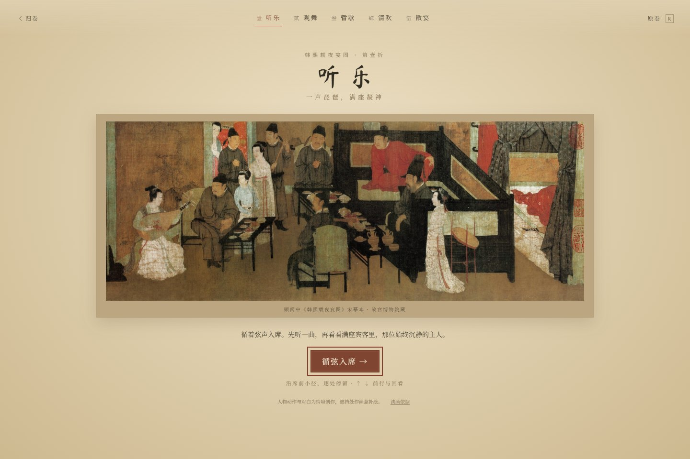
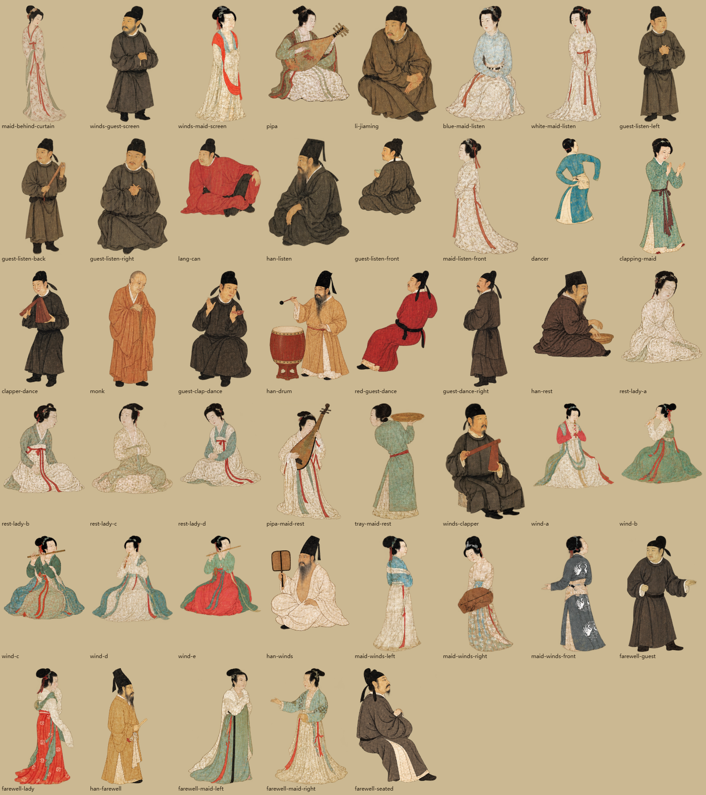
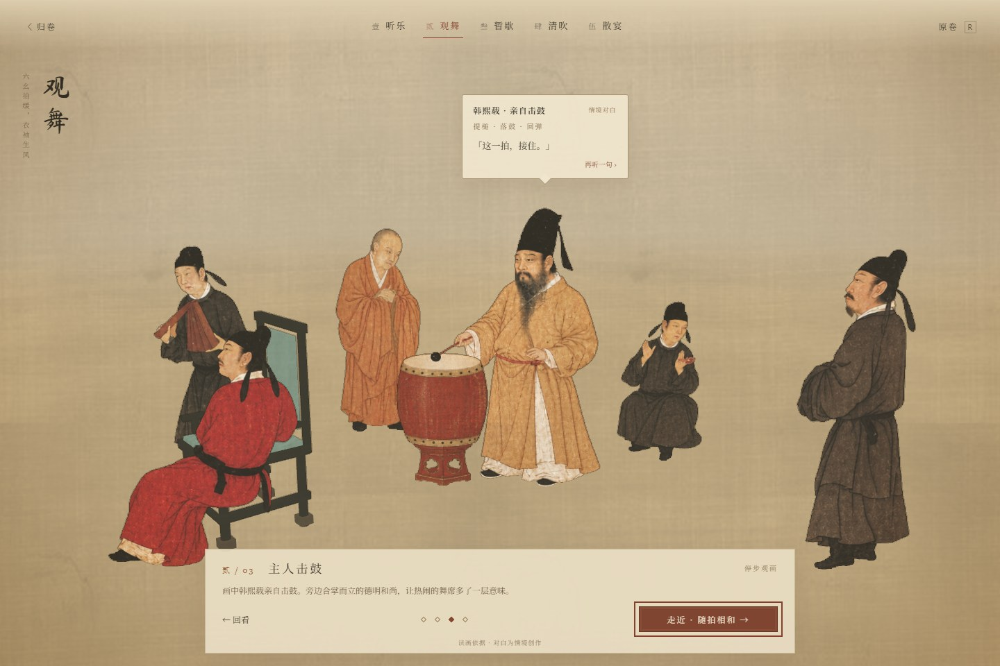

# 卷二：循席入画与完整纸偶

2026-10-12 · `feat/hanxizai-ye-yan`

当前版本把自由漫游改为五折线性观画剧情。每折先展开原画，点击后淡入对应场景；17 处停留点沿席前固定路线连接，靠近人物时出现动作说明与情境对白。保留原有蓝衣舞者和举杯循环，补足八组动作，修正人物与椅榻的穿插。没有增加分支任务、线索收集或存档系统。

## 画作依据与叙事边界

- [故宫博物院藏品介绍，单国强撰](https://www.dpm.org.cn/collection/paint/228200.html)：核对五段次序、人物身份和各段活动。史籍对作画缘起有不同记载，不把窥察或劝诫解释当作唯一事实。
- [故宫博物院：长卷的连续叙事](https://www.dpm.org.cn/classify_detail/180639.html)：参考屏风、家具如何串联时刻，以及席间热闹与主人沉静的对照。
- [Wikimedia Commons 全卷](https://commons.wikimedia.org/wiki/File:Gu_Hongzhong%27s_Night_Revels_1_complete_scene.jpg)：公有领域的宋摹本复制图。`panorama-detail.jpg` 为 13,898 × 1,200 原文件，旧的 5,200 × 449 原卷仍保留。
- [UNESCO 中国皮影戏介绍](https://ich.unesco.org/en/RL/chinese-shadow-puppetry-00421)：参考平面偶人及活动姿态。项目为屏幕动画，不是传统皮影制作或舞谱复原。

| 段落 | 固定停留点 | 画面关系与调整 |
| --- | --- | --- |
| 听乐 | 初入席、琵琶、主人、举杯宾客 | 保留琵琶与兄长、共榻的韩熙载和红衣郎粲；漆案外移，后排坐客避开椅扶手 |
| 观舞 | 群像、舞者、击鼓、拊掌 | 保留王屋山、韩熙载与德明和尚；鼓与击鼓人共用完整纸面，椅子后退 |
| 暂歇 | 榻前、净手、持琵琶侍女 | 围榻略加宽，坐客错位以露出头脸，删除重复的盆与占位靠枕 |
| 清吹 | 合奏、横笛、执扇主人 | 五位女乐保持成组坐姿；椅子、坐墩后退，侍女与执扇轮廓分开 |
| 散宴 | 群像、主人送别、席边应答 | 保留宾客与女伎交谈的组合，椅侧人物拉开间距 |

原画未提供完整建筑平面。家具间距、屏心山水、遮挡补全、镜头路线及动作是艺术转译，五段表示先后时刻，不是五间可考证的房屋。舞者保留原作背身姿态；“正面观看”指镜头始终位于纸偶有画面的前侧，不擅自翻转原画中的人物朝向。

`story.js` 中“画中所见”性质的说明与悬浮对白分开记录。对白是项目原创的宴席情境文字，界面始终标出“情境对白”，并提供“读画依据”链接。没有把创作台词当作历史引语。

## 分幕与路线

- `GuidedTour.js` 管理原画门页、入景、停留、移动和暂停状态。任何换折入口都先回到原画门页；当前章节的 `R` 对照会保留停留点。
- 摄像机沿相邻视点平滑移动，中途轻微向后避让。镜头与注视点共同插值，始终在所有家具和纸偶前方，不允许鼠标绕到背面或走入留白深处。
- 每次只显示当前折的人物与家具，切折时在门页遮盖下更换场景，避免跨越空场。原卷无需作为超宽 GPU 贴图加载。
- 窄屏采用同一条路线的近景适配，开场聚焦本折人物。对白投影到角色上方，避开底部导览。
- `↑ ↓` / `W S` 前行与回看，按钮支持触屏；`1—5` 换折，`R` 看原卷，`Esc` 暂停。无需指针锁定。
- “减少动态效果”下，路线即时到达、角色显示完整静止姿态，关闭纸面余颤和淡入动画。

## 完整性与动作

人物素材由内置 **imagegen** 参照原画和已审查的基础人物生成，补全遮挡并绘制新姿态；未使用 CLI。它们是生成式画意转译，**不是原画像素的无损抠取**。保留真实 alpha、完整面部、发髻、手袖与衣摆，运行时不再手描多边形切割脸部。

此前的小关节蒙皮仍会把乐器和衣纹拉扯出“空间扭曲”。当前已移除该运行方式，使用完整姿态轮播表达肘腕等动作，纸面几何保持刚性。`cast.js` 的旧关节点数据留作参考，不再驱动顶点变形；不宣称已经实现可任意操纵的独立骨骼。

| 动作素材 | 角色与动作 |
| --- | --- |
| `drink-cycle-v1.png` | 举杯宾客：持杯、举杯、小酌、离唇、放杯 |
| `dance-cycle-v1.png` | 蓝衣舞者：展袖、回身、顿步与归位，保留原循环 |
| `pipa-cycle-v2.png` | 琵琶女乐：拨弦、按弦、回腕 |
| `drum-cycle-v2.png` | 韩熙载与鼓：提槌、触鼓、回弹、候拍 |
| `fan-cycle-v2.png` | 执扇韩熙载：内摇、回扇、停听 |
| `wash-cycle-v2.png` | 暂歇韩熙载：探水、净手、收袖 |
| `clap-cycle-v2.png` | 拊掌女伎：分掌、合掌、回掌 |
| `flute-cycle-v2.png` | 中间横笛女乐：按孔、换指、续吹 |
| `send-cycle-v2.png` | 散宴韩熙载：持槌、抬手、送别 |
| `talk-cycle-v2.png` | 散宴坐客：倾听、应答、示意 |

击鼓姿态把人物、槌与鼓放进同一张完整纸面，触鼓帧的槌头落在鼓面上，删除原来不对齐的独立立体鼓。净手的盆也随原人物保留，删除重复盆体。

各动作保留停顿，并错开相位。非表演人物只作轻微整片倾动；镜头移动给纸面受限、可衰减的余颤，不拉伸人体。并非 45 个人都执行同样的大幅动作。

新素材先按 alpha 连通区域检查完整外轮廓，再以静止头部作只读配准，写入统一尺寸和偏移量。扇子与应答条的第四候选触及图像边缘，未采用；循环用完整的首姿回位。没有通过裁掉手或衣摆来凑等宽单元。

45 人共 75 个图集单元，当前打包为 3,520 × 3,584；透明边距防止邻图串色，宽高均小于 4,096。基础文件 `listen/dance/rest/winds/farewell-v1.png` 与专用帘后侍女仍保留。

提示词与工具记录：[基础素材](hanxizai-image-prompts.json)、[本轮八组动作](hanxizai-motion-prompts-v2.json)。所有文件位于 [`public/paintings/hanxizai-yeyan/puppets/`](../public/paintings/hanxizai-yeyan/puppets/)，不覆盖旧版本。

## 验证记录

- `npm test`：8 项。覆盖 45 人及全部姿态边界、十类动作循环、纸面弹簧稳定、原画门页与切折中断、17 处视点及整条路径的正面朝向、暂停续游、减少动态效果、视口变化，以及椅榻与纸偶间距。
- 浏览器巡检：实际点击五折 17 处停留点、跨折原画门页、前行回看、暂停续游、来源弹窗、续读对白、归卷。逐帧采样十类动作，确认几何顶点不变形。
- 390 × 844 竖屏：各折近景逐处检查，人物对白与底部按钮保持可见，减少动态效果时动作归静。
- 逐幕截图检查桌沿、椅扶手、榻边、脸部遮挡。保留原画中合理的前后遮挡，不把所有人物排成同一排。
- `npm run build` 与《江山秋色图》浏览器回归；公共渲染引擎和画卷一场景代码未改。Vite 的大包提示仍是已有体积限制，未新增生产依赖。

本地浏览器脚本和录屏仅用于验证。后续若要独立操纵每个关节，需要进一步制作分层、带遮挡补全的肢体素材；当前优先保证完整人物和清晰动作。
